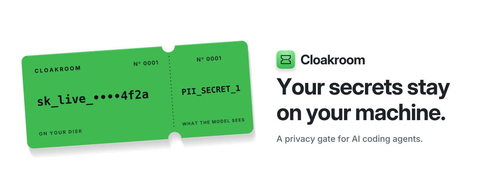
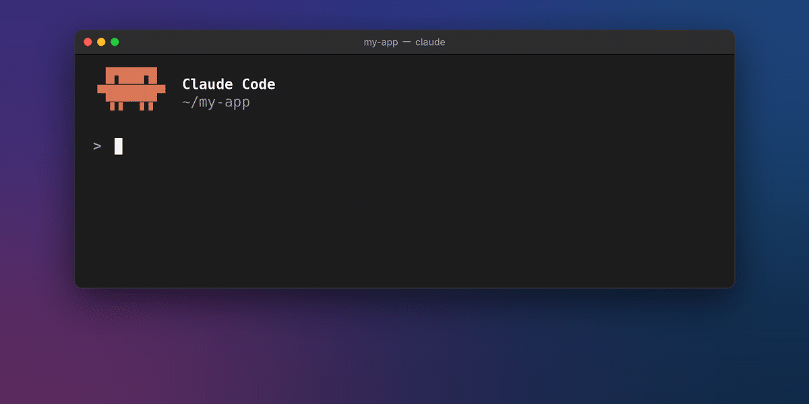

<div align="center">

<a href="https://cloakroom.sh">
<picture>
  <source media="(prefers-color-scheme: dark)" srcset="https://raw.githubusercontent.com/shanjeevrajendran/cloakroom/main/assets/title-card-dark.svg">
  <source media="(prefers-color-scheme: light)" srcset="https://raw.githubusercontent.com/shanjeevrajendran/cloakroom/main/assets/title-card-light.svg">
  
</picture>
</a>

<h3>
  <a href="https://cloakroom.sh">cloakroom.sh</a> ·
  <a href="https://cloakroom.sh/install">Install</a> ·
  <a href="https://cloakroom.sh/how-it-works">How it works</a> ·
  <a href="https://cloakroom.sh/security">Security</a> ·
  <a href="https://cloakroom.sh/commands">Commands</a> ·
  <a href="https://cloakroom.sh/releases">Releases</a>
</h3>

<p>
  <a href="https://pypi.org/project/cloakroom/"></a>
  <a href="https://pypi.org/project/cloakroom/"></a>
  <a href="https://github.com/shanjeevrajendran/cloakroom/actions/workflows/test.yml"></a>
  <a href="https://github.com/shanjeevrajendran/cloakroom/blob/main/LICENSE"></a>
</p>

**Cloakroom masks API keys, passwords and personal data on your machine before your AI coding agent sees them, and
puts the real values back in the files and commands the agent writes. Works with Claude Code, Codex, Gemini CLI and
Cursor. Free and open source.**

The full guide, settings and FAQ live at **[cloakroom.sh](https://cloakroom.sh)**. This README is the short version.

</div>

<p align="center">
  
  <br><sub>▶ <a href="https://www.youtube.com/shorts/U9lN4emgeE0">40-second demo</a></sub>
</p>

## Install

<a id="get-started"></a>

**Claude Code** (Mac, Windows, Linux). Inside Claude Code, one line at a time, then restart it:

```
/plugin marketplace add shanjeevrajendran/cloakroom
/plugin install cloakroom@cloakroom
```

The plugin installs the `cloakroom` program on first start. Until it is ready, the agent's file reads and commands
wait instead of passing unchecked.

<a id="codex"></a><a id="gemini-cli"></a><a id="cursor"></a>

**Codex, Gemini CLI, Cursor** (Mac, Linux):

```bash
uv tool install "cloakroom[model,torch,ocr]"   # Python 3.10+
cloakroom install codex                         # or: gemini, cursor
```

Codex skips new hooks until you trust them once: start `codex`, type `/hooks`, trust each Cloakroom entry.

**Check it:** `cloakroom doctor` (every line should say ok).

**Updates:** Claude Code updates the plugin, and the plugin updates the program. Codex, Gemini CLI, Cursor, git
commits, or a `cloakroom` you installed yourself: run `cloakroom update` in a terminal.

Step-by-step guide, updates and uninstall: [cloakroom.sh/install](https://cloakroom.sh/install).

## How it works

Cloakroom runs as hooks: checks the agent calls before and after each tool call. On the way in, pattern rules plus a
small local detection model find secrets and personal data, and each value is swapped for a placeholder such as
`PII_SECRET_1` that stays the same for the session. The pairs live in an encrypted vault on your machine, its key in
the OS keystore (Keychain, Credential Manager, Secret Service). On the way out, placeholders in writes and commands
get their real values back just before they run.

```
file or command output ──► Cloakroom (local) ──► model sees PII_PERSON_1, PII_SECRET_1
                                                         │
your disk gets the real value ◄── Cloakroom (local) ◄────┘ agent writes or runs with placeholders
```

Nothing leaves the machine except the one-time model download. If Cloakroom can't check something, it holds it
instead of letting it through. More: [cloakroom.sh/how-it-works](https://cloakroom.sh/how-it-works) ·
[docs-HOW-IT-WORKS.md](docs-HOW-IT-WORKS.md).

## What works where

✓ masked · ⛔ stopped or held · ✗ not covered

| | Claude Code | Codex (CLI, app) | Gemini CLI | Cursor (editor, agent) |
|---|---|---|---|---|
| Prompts you type | ⛔ stopped, safe copy offered | ⛔ stopped, safe copy offered | ⛔ stopped, safe copy offered | ⛔ editor · ✗ command-line agent |
| File reads, command output, MCP results | ✓ | ✓ · ✗ long-running commands | ✓ | ✓ |
| Images and PDFs (local OCR) | ✓ | ✓ | ✓ · ⛔ PDFs held | ✓ |
| Real values put back in writes and commands | ✓ | ✓ | ✓ | ✓ shell · ⛔ placeholder writes refused |
| Keys kept out of git commits | ✓ | ✓ | ✓ | ✓ |
| Prompt injection: sending keys out, approving its own holds, switching Cloakroom off | ⛔ | ⛔ · ✗ Codex web search | ⛔ | ⛔ · ✗ Cursor web search |
| Systems | Mac, Linux, Windows | Mac, Linux | Mac, Linux | Mac, Linux |

Every gap, with the reason: [docs-LIMITS.md](docs-LIMITS.md).

## Results

On held-out test sets Cloakroom let through 0 of 1,005 personal details (the other tools tested let through 119 to
992) and 0 of 77 keys and passwords in real vendor formats. The trade-off is false alarms: it masks more harmless
text than secret-only scanners. Method and raw numbers: [bench/RESULTS.md](bench/RESULTS.md).

## Recent releases

- **1.3.0**: an agent can't approve its own held call or switch Cloakroom off, and a hook or MCP server it writes
  into agent config is held until you type `cr: allow`.
- **1.2.0**: Cursor's editor is checked with Cloakroom (Tab completion isn't covered). Codex signed in with ChatGPT is
  masked through `cloakroom proxy`. Fewer false alarms on Codex's plugin list.
- **1.1.0**: Cursor's command-line agent (`cloakroom install cursor`), and `cloakroom allow` lets a held command run
  once.

All releases: [cloakroom.sh/releases](https://cloakroom.sh/releases) · [CHANGELOG.md](CHANGELOG.md).

## What it isn't

- **Not a sandbox.** It stops accidental leaks and contains prompt injection; it doesn't prevent it. An agent runs
  as you, so the agent's own sandbox is the outer wall.
- **Not everything has a hook.** Cursor's Tab completion and the vendors' own server-side web search aren't seen.
- **Typed prompts are stopped, not rewritten.** Agents let a hook block a prompt but not reliably change it.

<a id="ways-to-run"></a>

## Commands you'll use

| Command | What it does |
|---|---|
| `cloakroom doctor` | Health check, versions, per-check timing |
| `cloakroom dashboard` | Alerts in the browser: when it masks something harmless (a false alarm), mark it once in the dashboard and a rule stops it next time. |
| `cloakroom check FILE` · `explain FILE` · `mask FILE` | Preview what would be masked, and why |
| `cloakroom exposure` | It lists the keys and passwords your coding agents saw, so you know what to rotate. Hints only, never the key. |
| `cloakroom scan` | Commands a repo's agent and editor config would run |
| `cloakroom give NAME` | When the agent needs a key (a Stripe key, a database password), don't paste it into a prompt. This asks for it in a hidden prompt and gives you a placeholder to paste. |
| `cloakroom proxy` | Local masking proxy for tools that let you set their API address |
| `cloakroom allow` | Lets one held command run once. Works only in your own terminal, never the agent's shell. |
| `cloakroom update` | Update the program and set the hooks up again |

All commands: [cloakroom.sh/commands](https://cloakroom.sh/commands). Settings:
[cloakroom.sh/settings](https://cloakroom.sh/settings). Rules only, no model: `CLOAKROOM_MODE=rules`.

## Develop

```bash
git clone https://github.com/shanjeevrajendran/cloakroom && cd cloakroom
uv sync
uv run pytest -q tests      # rules mode, no model download
```

See [CONTRIBUTING.md](CONTRIBUTING.md). Found a way around it? Report it privately: [SECURITY.md](SECURITY.md).
Changes: [CHANGELOG.md](CHANGELOG.md).

## Credits

Detection model: [PII-Tracer](https://huggingface.co/perplexity-ai/PII-Tracer). The one-string hook command that runs
in both bash and PowerShell comes from [maisecrets](https://github.com/Mcpgate-de/maisecrets) (Apache-2.0).

Made by Shanjeev Rajendran · [GitHub](https://github.com/shanjeevrajendran) ·
[LinkedIn](https://www.linkedin.com/in/shanjeevrajendran) · Apache-2.0
